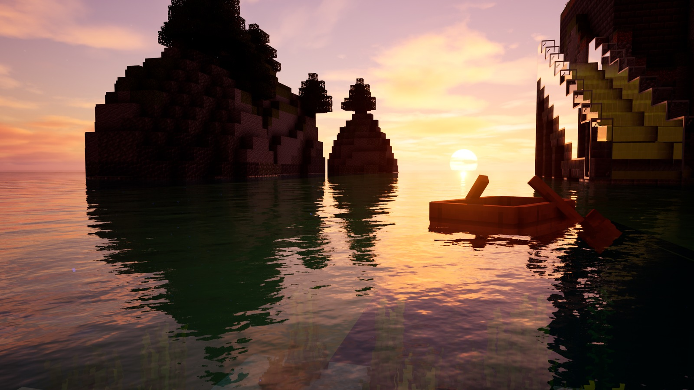

# VoxGlint

**用 Unreal Engine 实时渲染 Minecraft Java 版。**

VoxGlint 由一个 Fabric 客户端模组和一个 Unreal Engine 渲染器组成。Minecraft 照常运行世界、处理交互和生成原版界面。进入主菜单后，UE 接管窗口与输入，在同一窗口绘制地形、生物和第一人称物品，并叠加 Minecraft 的热栏、菜单和聊天框。

VoxGlint is a real-time Unreal Engine renderer for Minecraft Java Edition. [Contribute](CONTRIBUTING.md)

> VoxGlint 是独立社区项目，非 Minecraft 官方产品，与 Mojang 或 Microsoft 无隶属关系，也未获其认可。



## 当前版本

**v0.28.2 · Windows x64 · Minecraft Java 26.2 · 桥接协议 v28**

- 游戏使用 Fabric Loader 0.19.5 和 Java 25，UE 渲染器使用 DirectX 12 / Shader Model 6。此前的 Windows 实机验证覆盖单人游戏和窗口交接。本次公开源码已通过 Fabric 构建、合约测试和 UE 5.8.4 编辑器目标构建。
- 首发提供项目源代码和 Fabric 模组 JAR。Windows 渲染器需要用 Unreal Engine 5.8 自行构建，安装时请将同版本的两端一起使用。[GitHub Releases](https://github.com/LIy-hub/VoxGlint/releases)

## 画面与控制

- UE 绘制随游戏变化的日夜、天气和体积云。水体有岸边涟漪、船尾迹和瀑布飞溅，水下光按穿过水体的距离衰减和散射。
- 资源包可以提供 LabPBR 材质。VoxGlint 同步动态纹理和模型，并用纹理决定哪些区域发光。染色玻璃透光可在设置中开启，目前默认关闭。
- 画质与色彩在 Minecraft 的「视频设置 → VoxGlint 渲染设置…」中调整。设备支持时可使用硬件光追和路径追踪摄影。

## 构建与安装

准备 JDK 25、Unreal Engine 5.8（实测 5.8.4）、MSVC C++ 工具链和 Windows SDK。首次构建 Fabric 模组时，Gradle Wrapper 会联网下载依赖。在项目根目录用 PowerShell 执行，按提示填写 UE 安装目录。

```powershell
$ue = Read-Host 'Unreal Engine 5.8 安装目录'
.\Package-Renderer.ps1 -EngineRoot $ue
.\fabric-bridge\gradlew.bat -p .\fabric-bridge build
```

将 `fabric-bridge/build/libs/voxglint-0.28.2.jar` 放进对应 Minecraft 实例的 `mods`，把 `dist/minecraftue-renderer` 整个目录放到该实例的游戏目录（与 `options.txt` 同级）。随后从启动器启动该 Fabric 实例，模组会启动渲染器。[完整安装说明](docs/renderer-guide.md#安装并启动-windows-版) · [编辑器联调](docs/renderer-guide.md#编辑器联调)

## 一起开发

我很期待和大家一起把 VoxGlint 做下去。很多渲染问题只有换一台机器、一个资源包或一个真实存档才会碰到。如果你愿意带一个复现、一组对照图，或者一段想改的代码来，我们就可以从那里一起做。

—— 项目所有者与维护者 [LIy-hub](https://github.com/LIy-hub)

- **游玩和测试**。首轮征集不同显卡上的 F11 全屏切换和窗口缩放反馈，重点看准星、热栏和菜单点击的位置。遇到切维度、资源重载等异常，也欢迎附版本、复现步骤和日志。[参与首轮实测（#1）](https://github.com/LIy-hub/VoxGlint/issues/1) · [提交 Issue](https://github.com/LIy-hub/VoxGlint/issues/new)
- **Fabric 和资源包**。欢迎补充方块模型、粒子、LabPBR 的兼容样例，或改进 Sodium 设置入口和现有合约测试。[Fabric 桥接](fabric-bridge/)
- **UE 和着色器**。欢迎用现有回放检查水体、玻璃和天气，或在同机位采集帧时间，帮助定位区段上传和渲染的开销。[UE 源码](ue-renderer/Source/) · [回放脚本](ue-renderer/Scripts/)

中文和英文的 Issue、PR 都欢迎。[查看 Issues](https://github.com/LIy-hub/VoxGlint/issues) · [查看 Pull Requests](https://github.com/LIy-hub/VoxGlint/pulls) · [贡献指南](CONTRIBUTING.md) · [桥接协议](protocol/README.md)

## 许可

VoxGlint 自有代码采用 Apache-2.0 许可证。截图中的 Minecraft 游戏内容和商标归各自权利人所有。[Apache-2.0 许可证](LICENSE) · [版权声明](NOTICE) · [第三方声明](THIRD_PARTY_NOTICES.md)
